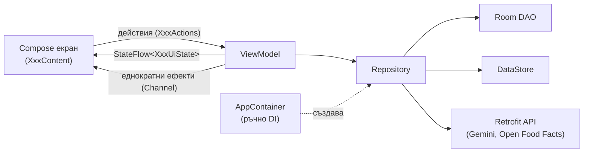
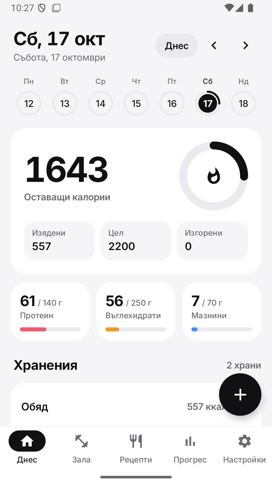
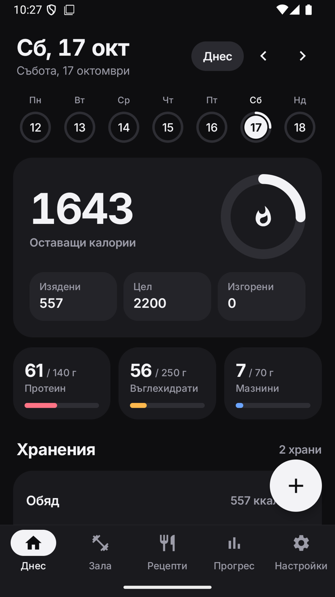
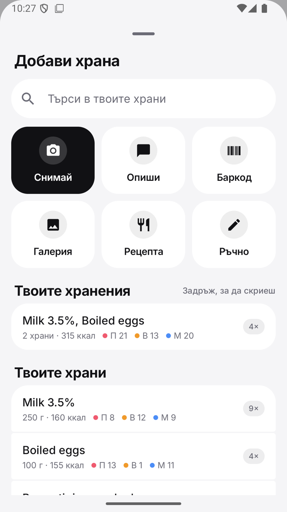
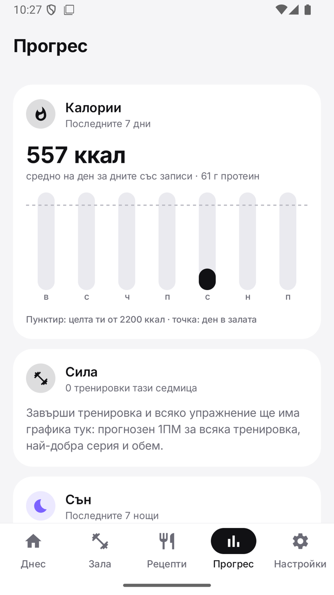

# MacroSnap

Android приложение за проследяване на храненето: снимаш чинията си и AI модел (Google Gemini)
разпознава храните, грамажа и макронутриентите; ти поправяш каквото не е точно и записваш.
Освен храна следи витамини и минерали, добавки, вода, сън, тегло и тренировки във фитнеса.
Всички данни се пазят локално на телефона.

## Идея

Ръчното въвеждане на всяка храна в калориен дневник е бавно и затова повечето хора се отказват
след няколко дни. MacroSnap съкращава записа до няколко секунди:

- **снимка** на храната → AI оценява продуктите, грамовете и хранителните стойности;
- **баркод** на пакетирана храна → етикетът се взима от Open Food Facts;
- **описание с думи** („50 г зехтин, 2 яйца, чаша варен ориз“) → AI го превръща в продукти;
- **история** → храните и комбинациите, които ядеш често, се добавят с едно докосване, без AI заявка.

AI оценката никога не се записва директно: винаги минава през екран за преглед, където
потребителят коригира количества и стойности. Приложението е на английски и български.

## Как работи

### Добавяне на храна

1. На екран **Днес** бутонът „+“ отваря листа **Добави храна** с шест начина: Снимай, Опиши,
   Баркод, Галерия, Рецепта и Ръчно, плюс списъци „Твоите хранения“ и „Твоите храни“.
2. Всеки начин води до един и същ екран **Преглед** (`ReviewScreen`), който получава източника като
   параметър на навигацията (`ReviewRoute`):
   - **Снимка / галерия** – снимката се прави от системното приложение за камера
     (`ActivityResultContracts.TakePicture`, Camera Intent) или се избира с Photo Picker. Преди
     изпращане `ImageEncoder` я смалява до ≤ 1024 px. `GeminiFoodAnalyzer` изпраща снимката
     и промпт към Gemini REST API и иска отговор в строго зададена JSON схема (structured output).
     Отговорът се парсва с kotlinx.serialization, а стойностите се ограничават до физически
     възможни граници (напр. ≤ 900 kcal/100 г).
   - **Баркод** – Google Code Scanner (ML Kit) прочита EAN/UPC кода, а `ProductRepository` пита
     Open Food Facts REST API. Данните от там са въведени от потребители, затова приложението ги
     проверява: поправя kJ, въведени като kcal; когато енергията не съвпада с макросите, избира
     стойността, която макросите потвърждават; маркира невъзможни стойности и порции и показва
     предупреждения на екрана за преглед. Липсващите витамини се оценяват от Gemini веднъж за
     всеки баркод и се кешират в таблица `product_micros`.
   - **Описание** – текстът отива към Gemini по същия начин като снимката.
   - **Ръчно / рецепта / история** – попълват се директно, без мрежова заявка.
3. На екрана за преглед всеки продукт може да се редактира (име, грамове, kcal, протеин,
   въглехидрати, мазнини, витамини), да се изтрие или да се добави нов. „Запиши“ записва всичко
   в базата чрез `FoodRepository.addAll`.

### Модел на данните

- Храната (`FoodItem`) пази хранителните стойности **на 100 г** плюс изядените грамове, а
  общите стойности се изчисляват. Така промяната на грамажа (най-честата грешка на AI) преизчислява
  всичко коректно.
- Витамините и минералите са `Map<Nutrient, Double>`. Липсващ ключ означава „неизвестно“, а не нула.
- „Твоите храни“ и „Твоите хранения“ не се пазят отделно, а се извличат от историята в
  `food_entries`: групират се по име, а подредбата е по честота с тежест за скорошност.

### Съхранение

- **Room** (SQLite) база `macrosnap.db`, версия 8, с 15 таблици: `food_entries`, `recipes`,
  `recipe_ingredients`, `supplements`, `supplement_logs`, `water_logs`, `sleep_logs`,
  `weight_entries`, `exercises`, `routines`, `routine_exercises`, `workouts`, `workout_sets`,
  `pending_photos` и `product_micros`. Всяка промяна на схемата има ръчно написана `Migration`,
  така че данните оцеляват при обновяване на приложението.
- **DataStore** пази настройките: API ключ, списък с модели, цели, профил, език.
- Снимките се пазят в личната папка на приложението и се трият заедно с последния запис, който
  ги използва.

### Пълен CRUD през интерфейса

| Обект | Създаване | Четене | Редакция | Изтриване |
|---|---|---|---|---|
| Хранене | Добави храна → Преглед → Запиши | Днес, Прогрес | Докосни запис → Редактирай | Докосни запис → Изтрий |
| Рецепта | Рецепти → Нова рецепта | Рецепти | Отвори рецепта | Рецепта → Изтрий |
| Добавка | Настройки → Добавки | Днес (чеклист) | Отвори добавка | Отвори добавка → Изтрий |
| Тренировка | Зала → Започни тренировка | Зала → История, Прогрес | Отвори тренировка | Тренировка → Изтрий |
| Програма | Зала → Нова програма | Зала | Отвори програма | Програма → Изтрий |
| Упражнение | Зала → Упражнения → Добави | Зала → Упражнения | Отвори упражнение | Отвори упражнение → Изтрий |
| Вода, сън, тегло | Днес / Прогрес | Днес / Прогрес | Сън, тегло | Вода (отмяна), сън, тегло |

### Грешки и работа без интернет

- Всичко освен AI анализа и търсенето по баркод работи без интернет.
- Мрежовите грешки се превръщат в `DataError` (няма ключ, грешен ключ, лимит за минута/ден,
  сървърна грешка, няма мрежа) и потребителят вижда ясно съобщение.
- Ако Gemini е претоварен или лимитът е изчерпан, снимката не се губи: остава в
  „Чакат анализ“ на екран Днес и може да се изпрати отново по-късно.
- Приложението пробва моделите от настройките по ред и минава към следващия само при
  изчерпан лимит, недостъпен модел или сървърна грешка.

### Разрешения

Приложението иска само `INTERNET`. Камерата се ползва чрез системното приложение за камера
(Camera Intent), баркодът чрез Google Code Scanner, а галерията чрез Photo Picker. Затова не са
нужни разрешения за камера или за файлове.

## Архитектура

**MVVM + Repository слой + ръчно DI**, един модул `:app`, Kotlin и Jetpack Compose (Material 3).



- **Слоеве** (`app/src/main/java/com/macrosnap/app/`):
  - `model/` – чисти Kotlin типове и логика (`FoodItem`, `Macros`, `Nutrient`, история на храните);
  - `domain/` – изчисления (`GoalCalculator` по Mifflin-St Jeor, `CalorieBurnEstimator` по MET);
  - `data/` – Room (`local/`), Retrofit клиенти (`remote/`), DataStore (`settings/`) и
    репозиториите, които ги обединяват;
  - `ui/` – екраните, разделени по област (`today`, `review`, `recipes`, `workouts`, `progress`,
    `settings`, `supplements`) и споделени компоненти и тема.
- **DI** – `AppContainer` създава базата, DataStore, HTTP клиентите и репозиториите веднъж за
  цялото приложение. ViewModel-ите ги получават чрез `ViewModelProvider.Factory`.
- **Всеки екран** има `XxxUiState` (data class с изчислени стойности), интерфейс `XxxActions`,
  който ViewModel-ът имплементира, еднократни `XxxEffect` (напр. snackbar) през `Channel` и
  composable без собствено състояние `XxxContent(uiState, actions)`.
- **Навигация** – Navigation Compose с типизирани `@Serializable` маршрути (`ui/Routes.kt`). Една
  Activity (`MainActivity`) и 11 екрана. Долната лента се показва на петте основни екрана: Днес,
  Зала, Рецепти, Прогрес и Настройки.
- **Жизнен цикъл** – ефектите се събират с `repeatOnLifecycle(STARTED)`, а състоянието на
  екрана за преглед се пази в `SavedStateHandle`, така че оцелява и ако системата убие процеса,
  докато е отворена камерата. Датата „днес“ следи часовника, за да се смени в полунощ.
- **AI като абстракция** – `FoodAnalyzer` е интерфейс; `GeminiFoodAnalyzer` е единствената
  имплементация и може да се смени, без да се пипа UI.

**Технологии:** Kotlin 2.4, Jetpack Compose + Material 3 (светла и тъмна тема), Navigation
Compose, Room, DataStore, Retrofit + OkHttp + kotlinx.serialization, Coil, ML Kit Code Scanner,
корутини и Flow.

## Потребителски поток

1. **Първо стартиране** – отваря се екран Днес. В **Настройки** потребителят поставя безплатен
   Gemini API ключ („Вземи безплатен ключ“ → Google AI Studio) и натиска „Запази и провери“.
   По желание попълва профила си и калкулаторът предлага цели за калории и макроси.
2. **Записване на хранене** – Днес → „+“ → **Снимай** → снима чинията → по желание добавя
   подсказка („пилешко, около 200 г“) → AI връща списък с продукти → потребителят поправя
   грамажа → **Запиши**. Храненето се появява под съответното хранене (закуска, обяд…), а
   калорийният пръстен и лентите за макроси се обновяват.
3. **Баркод** – „+“ → **Баркод** → сканира опаковката → стойностите от етикета се зареждат.
   Ако има съмнителни стойности, се показва предупреждение → **Запиши**.
4. **Повторение** – „+“ → докосване на храна или хранене от „Твоите храни/хранения“ → записва се
   с обичайното количество, без AI заявка.
5. **Редакция и изтриване** – докосване на запис в Днес → **Редактирай** (промяна на грамове
   или стойности) или **Изтрий** (с потвърждение).
6. **Фитнес** – Зала → **Започни тренировка** → добавяне на упражнения и серии
   (тежест × повторения) → таймер за почивка → **Завърши**. Показват се новите лични рекорди,
   а изгорените калории се отчитат в Днес.
7. **Прогрес** – графики за калории, сън, вода и тегло за 7 дни и графика на силата по
   упражнение.

## Стъпки за стартиране

### Инсталиране на готовия APK

1. Свали [`apk/app-release.apk`](apk/app-release.apk) на Android телефон (Android 7.0 или по-нов).
2. Отвори файла и разреши „инсталиране от неизвестни източници“, когато бъдеш попитан.
3. Стартирай MacroSnap и следвай „Тестови акаунти“ по-долу, за да включиш AI функциите.

### Компилиране от кода

Изисквания: Android Studio (последна стабилна версия) или JDK 17 и Android SDK 37.

```bash
git clone https://github.com/nikkivasilev/MobileApps2025-<ФН>.git
cd MobileApps2025-<ФН>
./gradlew :app:installDebug          # инсталира на свързано устройство или емулатор
```

От Android Studio: **File → Open** → папката на проекта → **Run ▶**.

Release build: `./gradlew :app:assembleRelease`. Ако липсва `keystore.properties` (ключът за
подписване не е в репото), build-ът се подписва с debug ключа, така че проектът се компилира
навсякъде.

### Тестове и качество на кода

```bash
./gradlew :app:testDebugUnitTest            # 245 unit теста (JVM)
./gradlew :app:koverHtmlReportLogic         # покритие: app/build/reports/kover/htmlLogic/index.html
./gradlew :app:connectedDebugAndroidTest    # UI тест (след теста Gradle деинсталира приложението)
./gradlew :app:ktlintCheck :app:detekt      # стил на кода
```

- **Unit тестове** (`app/src/test`) – модели, изчисления на цели и изгорени калории, обработка
  на отговорите на Gemini (вкл. превключване между модели и лимити), проверките на Open Food
  Facts, личните рекорди в залата, запазване на чернова при убит процес и изчислените стойности
  на екраните. Ползват ръчно написани fake-ове вместо Android класове. Покритие на логиката
  (без composable функции и генериран код): **~40 % от редовете**.
- **UI тест** (`app/src/androidTest/.../LogFoodFlowTest.kt`, Compose UI Test + Espresso) –
  основният сценарий: ръчно добавяне на храна → проверка, че се вижда в Днес → промяна на
  грамажа → изтриване. Тестът подменя базата с такава в паметта (`MacroSnapTestRunner`), така
  че не пипа истинските данни и не изисква API ключ.
- **ktlint и detekt** минават без грешки (конфигурация в `.editorconfig` и `config/detekt/detekt.yml`).

## Тестови акаунти

Приложението няма регистрация или вход: това е лично приложение за един потребител и всички
данни са на устройството.

За AI функциите (снимка, описание, оценка на витамини) е нужен **безплатен Gemini API ключ**:

1. Настройки → **Вземи безплатен ключ** (отваря https://aistudio.google.com/apikey) → вход с
   Google акаунт → **Create API key**.
2. Постави ключа в полето **Gemini API ключ** → **Запази и провери** → трябва да се появи
   „Ключът работи.“

Без ключ работят: баркод скенерът (Open Food Facts не изисква ключ), ръчното въвеждане,
рецептите, историята, водата, сънят, теглото, залата и прогресът. Безплатният лимит на Gemini
е ограничен (обикновено десетки до стотици заявки на ден), затова повторното записване от
историята не използва заявки.

## Скрийншотове

| Днес | Днес (тъмна тема) | Добави храна | Прогрес |
|---|---|---|---|
|  |  |  |  |

## APK

- Файл: [`apk/app-release.apk`](apk/app-release.apk)
- Размер: около 13 MB
- Подписан с release ключ; minSdk 24 (Android 7.0), targetSdk 37.

Подробно описание на английски: [docs/README.en.md](docs/README.en.md).
